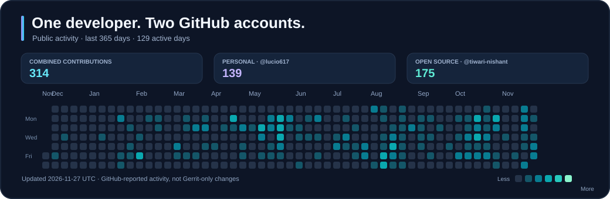

  

  # Hey, I'm Nishant Tiwari 👋

  **Software Engineer @ IBM · Open-Source Contributor · Full-Stack Builder**

  I like taking ideas from a whiteboard to something people can actually use.

  
  
  
  

---

### 👨‍💻 A little about me

- 💼 Building management experiences for **OpenBMC** at **IBM**, with a focus on frontend architecture, reliability, and user experience.
- 🚀 Helped move a production UI from **Vue 2 to Vue 3**, contributing fixes and features across authentication, logs, power operations, and system management.
- 🧱 Comfortable going end-to-end: **React / Next.js / Vue / TypeScript** on the frontend; **Node.js / Express / Python / PostgreSQL** behind the scenes.
- 🤝 I enjoy open source, code reviews, and translating real user needs into working software.
- 🎓 **B.Tech in Computer Science**, VIT Vellore (2023).
- 🎮 Away from the editor: gaming, tinkering with automations, and exploring what's next in AI engineering.

### 🌍 Open source & impact

| Area | Highlights |
| --- | --- |
| **OpenBMC Web UI** | **50+ contributed changes** across the open-source project; Vue 3 migration, features, accessibility and defect fixes. |
| **Vue 3 migration** | Worked through **25+ defects** and **12 features**, including event logs, MFA, user management and other platform workflows. |
| **Enterprise applications** | Contributed to full-stack architecture using **Next.js, Express and PostgreSQL**; built **5 Dockerized microservices** for an IBM project. |
| **Developer Jumpstart** | Led the delivery team across **3 React + Flask modules**, collaborating with business sponsors and end users. |

> My open-source contributions were made using a separate work GitHub identity. Both profiles are linked below so you can inspect the original public history. No accounts or commit authors have been merged.

  
  
  

### 📈 One developer, two GitHub accounts

  

Generated daily from the **public contribution calendars** of [@lucio617](https://github.com/lucio617) and [@tiwari-nishant](https://github.com/tiwari-nishant). Each day's value is the sum of GitHub-reported contributions from both accounts; it is **not** GitHub's native profile graph and does not include Gerrit-only changes or private activity. [How it works](./scripts/README.md).

### 🔨 Selected projects

| Project | What I worked on | Explore |
| --- | --- | --- |
| **OpenBMC Web UI** | Vue 3 migration, administration screens, security and usability improvements | [Project](https://github.com/openbmc/webui-vue) · [Work profile](https://github.com/tiwari-nishant) |
| **Gerrit Monitor** | Developer tooling to keep track of Gerrit activity | [Repository](https://github.com/tiwari-nishant/Gerrit-Monitor) |
| **API Monitor** | Browser extension for tracking and exporting API calls | [Repository](https://github.com/tiwari-nishant/API-Monitor) |
| **Expense Tracker** | Full-stack expense tracking application | [Repository](https://github.com/lucio617/expense-tracker-fullStack) |
| **mlearning** | An R package from my early machine-learning exploration | [Repository](https://github.com/lucio617/mlearning) |

### 🛠️ Technologies I use

  &nbsp;&nbsp;
  &nbsp;&nbsp;
  &nbsp;&nbsp;
  &nbsp;&nbsp;
  &nbsp;&nbsp;
  &nbsp;&nbsp;
  &nbsp;&nbsp;
  &nbsp;&nbsp;
  &nbsp;&nbsp;
  &nbsp;&nbsp;
  &nbsp;&nbsp;
  

### 🔥 A little GitHub fun

**The combined contribution snake** 🐍 *(public activity from @lucio617 + @tiwari-nishant)*

  

  

---

  <em>Have an interesting engineering problem or open-source idea? Let's build something useful.</em> 🚀

